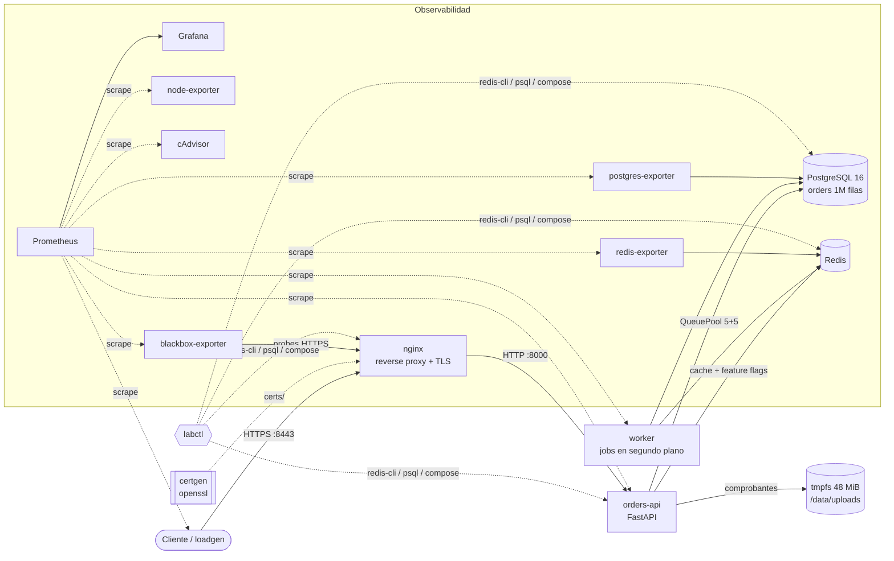

# rca-incident-lab

Laboratorio de análisis de causa raíz (RCA). Un sistema chico pero realista en Docker Compose al que se le inyectan fallas reproducibles para practicar diagnóstico de incidentes y escritura de postmortems.

Cada escenario trae los síntomas que vería un usuario o el monitoreo, un runbook paso a paso con los comandos exactos, las consultas PromQL, cómo confirmar la causa raíz, la mitigación inmediata frente a la solución definitiva, alertas de Prometheus que lo detectan y un postmortem sin culpas de ejemplo.

## Arquitectura



| Componente | Rol |
|---|---|
| `nginx` | Termina TLS con un certificado firmado por una CA local, reenvía a la API, loguea `rt`/`urt` por request |
| `api` (`services/orders`) | API de órdenes en FastAPI + SQLAlchemy. Expone métricas RED y de saturación en `/metrics` |
| `worker` | Procesa órdenes pendientes y corre la conciliación de stock |
| `postgres` | Postgres 16 con `pg_stat_statements`, `log_lock_waits` y `log_min_duration_statement` |
| `redis` | Cache de productos y feature flags (`fault:*`) |
| `loadgen` | Generador de carga asíncrono (asyncio + httpx) con métricas del lado cliente |
| `prometheus` + `grafana` | Datasource y dashboard provisionados (latencia p50/p95/p99, error rate, RPS, pool, memoria, CPU, disco, TLS) |
| exporters | `postgres-exporter`, `redis-exporter`, `node-exporter`, `cadvisor`, `blackbox-exporter` |
| `certgen` | Genera la CA, el certificado válido y el vencido con `openssl` |

## Escenarios

| Escenario | Síntoma | Causa | Herramienta de diagnóstico |
|---|---|---|---|
| [memory-leak](scenarios/memory-leak/README.md) | La memoria de la API sube en rampa, 502 intermitentes y reinicios | Cache local con el request id en la clave, nunca se libera. OOM kill por `mem_limit` | `docker stats`, `docker inspect` (`OOMKilled`), `process_resident_memory_bytes` |
| [db-lock](scenarios/db-lock/README.md) | `POST /orders` tarda 30 s y termina en 504, después todo da 503 | El worker toma `SELECT ... FOR UPDATE` y espera una llamada externa con la transacción abierta | `pg_stat_activity`, `pg_locks`, `pg_blocking_pids()`, logs de lock waits |
| [connection-pool-exhaustion](scenarios/connection-pool-exhaustion/README.md) | 503 con `QueuePool limit of size 5 overflow 5 reached` y Postgres sano | Sesiones que se abren y nunca se cierran | `db_pool_checked_out`, `pg_stat_activity` por `application_name`, `py-spy dump` |
| [disk-full](scenarios/disk-full/README.md) | Solo fallan las escrituras (`POST /orders` 500), las lecturas andan | Un archivo de export llenó el volumen, `ENOSPC` | `df -h`, `du`, `find -size`, `uploads_disk_free_bytes` |
| [expired-cert](scenarios/expired-cert/README.md) | Los clientes fallan con error TLS y el servidor "no ve nada" | nginx sirve un certificado con `notAfter` en el pasado | `openssl s_client`, `openssl x509 -dates`, `probe_ssl_earliest_cert_expiry` |
| [dns-broken](scenarios/dns-broken/README.md) | `/readyz` 503, liveness OK, errores `failed to resolve host` | Cambio de config: `DB_HOST` apunta a un nombre que no existe | `getent hosts`, `dig`, `docker compose config`, `docker inspect` |
| [slow-query](scenarios/slow-query/README.md) | p99 alto en `/customers/{id}/orders`, CPU de Postgres arriba | Se borró el índice `ix_orders_customer_id`, Seq Scan sobre 1M filas | `pg_stat_statements`, `EXPLAIN (ANALYZE, BUFFERS)`, `pg_stat_user_tables` |
| [cpu-spike](scenarios/cpu-spike/README.md) | API congelada, CPU al 100%, scrapes y healthchecks fallan | Regex vulnerable a backtracking catastrófico (ReDoS) en la validación | `top -H`, `py-spy dump`, timing de la regex aislada |

Las fallas se activan como pasarían en la realidad. Un feature flag en Redis habilita código con un bug (memory-leak, db-lock, connection-pool-exhaustion, cpu-spike). También puede ser un cambio de configuración con `docker compose` (dns-broken), un cambio en la base por SQL (slow-query) o un archivo en disco o un certificado (disk-full, expired-cert).

## Inicio rápido

Requisitos: Docker con Compose v2, Python 3.11+ para `labctl`, `make` opcional.

```bash
cp .env.example .env                 # opcional, todo tiene valores por defecto
python -m venv .venv && . .venv/bin/activate   # en Windows: .venv\Scripts\activate
pip install -r requirements.txt      # instala labctl
make up-load                         # docker compose --profile load up -d --build
```

El primer arranque tarda un par de minutos porque Postgres carga un millón de órdenes. Después:

| URL | Qué es |
|---|---|
| https://localhost:8443/readyz | API a través de nginx (usar `--cacert certs/ca.crt`) |
| http://localhost:3000 | Grafana, dashboard **RCA Lab - Overview** (admin/admin) |
| http://localhost:9090/alerts | Prometheus con las alertas de todos los escenarios |

```bash
curl --cacert certs/ca.crt https://localhost:8443/readyz
labctl status
```

## Cómo jugar

### Modo guiado

```bash
labctl list                       # escenarios disponibles
labctl break slow-query           # activa la falla
# abrir scenarios/slow-query/README.md y seguir el runbook
labctl fix slow-query             # revierte
```

### Modo desafío

```bash
labctl break random               # activa un escenario al azar y no te dice cuál
labctl status                     # muestra la salud vista por el cliente y "???"
```

Las reglas: no leer los README de los escenarios. Solo se puede usar [la metodología](docs/metodologia.md): observar (Grafana, `labctl status`, `docker compose ps`), anotar hipótesis, probarlas con un comando cada una y aislar el componente. Cuando tengas la causa raíz escrita en una línea:

```bash
labctl status --reveal            # muestra el escenario, la causa y los flags activos
labctl fix all                    # revierte lo que esté activo
```

Para practicar el cierre del incidente, escribí tu propio postmortem con [la plantilla](docs/plantilla-postmortem.md) y comparalo con el de `scenarios/<escenario>/postmortem.md`.

### Comandos de labctl

| Comando | Qué hace |
|---|---|
| `labctl list` | Lista escenarios con su síntoma principal |
| `labctl break <escenario>` | Activa la falla |
| `labctl break random [--seed N]` | Modo desafío: activa uno al azar y lo oculta |
| `labctl fix <escenario>` | Revierte la falla (mitigación del laboratorio) |
| `labctl fix all [--force]` | Revierte los activos, o todos con `--force` |
| `labctl status [--reveal]` | Probes HTTPS a través de nginx y escenarios activos |

`labctl` se puede usar también como `python -m labctl`. Variables: `LAB_BASE_URL` (por defecto `https://localhost:8443`) y `LAB_ROOT` (raíz del repo).

## Documentación

- [Metodología de RCA](docs/metodologia.md): observar, formular hipótesis, probar y aislar. Métodos RED y USE, 5 porqués, Ishikawa.
- [Plantilla de postmortem](docs/plantilla-postmortem.md)
- [Glosario](docs/glosario.md)

## Estructura

```text
.
├── docker-compose.yml          # stack completo (proyecto "rca-lab")
├── services/
│   ├── orders/                 # API FastAPI + worker (misma imagen)
│   ├── loadgen/                # generador de carga asyncio + httpx
│   └── certgen/                # CA local y certificados (openssl)
├── labctl/                     # CLI de inyección de fallas
├── scenarios/<escenario>/      # README (runbook), postmortem.md, alerts.yml
├── db/init/                    # esquema y seed de Postgres
├── nginx/  prometheus/  blackbox/  grafana/
├── docs/                       # metodología, plantilla, glosario
└── tests/                      # pytest
```

## Desarrollo

```bash
python -m venv .venv
.venv/bin/pip install -r requirements-dev.txt   # Windows: .venv\Scripts\pip
pytest
ruff check . && ruff format --check .
```

Los tests no necesitan Docker:

- **API**: FastAPI `TestClient` con SQLite en archivo y un `QueuePool` real, así el agotamiento del pool se reproduce de verdad. Flags y cache en memoria.
- **Fallas**: cada defecto se ejercita en el código (fuga de memoria, fuga de sesiones, `ENOSPC` con rollback, liveness frente a readiness, crecimiento exponencial de la regex, lock del worker).
- **labctl**: con clientes falsos de Docker y HTTP se valida qué comandos ejecuta cada `break` y `fix`, el modo desafío y el manejo de errores.
- **Documentación**: cada escenario tiene README y postmortem con las secciones obligatorias en orden, 5 porqués y action items con dueño y prioridad.
- **Configuración**: compose, Prometheus, reglas, blackbox, Grafana y nginx parsean y son consistentes entre sí (servicios, puertos, jobs, métricas, rutas de montaje).

## CI

`.github/workflows/ci.yml`:

1. **lint**: `ruff check` y `ruff format --check`.
2. **test**: pytest en Python 3.11, 3.12 y 3.13.
3. **compose**: `docker compose config --quiet` (también con el override de dns-broken) y build de imágenes.
4. **promtool**: `promtool check config` y `promtool check rules` con la imagen `prom/prometheus`.
5. **smoke**: levanta el stack, espera `/readyz` a través de nginx y corre tres escenarios de punta a punta. En slow-query verifica que el plan pase a `Seq Scan` y que la latencia suba, y que el fix vuelva al índice. En dns-broken espera que `/readyz` dé 503 y que vuelva a 200. En expired-cert espera que `curl` falle con código 60 y que vuelva a validar. Si algo falla vuelca logs y siempre termina con `docker compose down -v`.

## Decisiones de diseño

- **Fallas dentro del código, detrás de flags**: el código con bug convive con el correcto, como un cambio desplegado a medias. Los síntomas salen solos en métricas y logs, nada "simula" un error.
- **Pool chico a propósito** (5 + 5, timeout 5 s): hace visible el efecto cascada de locks y fugas.
- **Un solo proceso uvicorn**: simplifica las métricas y deja ver el efecto del GIL en cpu-spike.
- **Liveness y readiness separados**: `/healthz` no toca dependencias y `/readyz` sí. dns-broken muestra por qué importa.
- **nginx resuelve el upstream en cada request** (`resolver 127.0.0.11`): sin eso, recrear la API deja a nginx apuntando a una IP vieja, que es otro incidente clásico.
- **CA local**: los clientes validan contra `certs/ca.crt` en lugar de usar `-k`. Así un certificado vencido falla como en producción.
- **Vista del cliente**: blackbox y las métricas del loadgen muestran lo que el servidor no ve (TLS, DNS, timeouts).

## Limitaciones

- No se incluye Loki/Promtail. Los logs se leen con `docker compose logs`.
- cAdvisor y node-exporter dependen del host. En Docker Desktop (Windows/macOS) algunas métricas de contenedor o de disco pueden faltar. Las alertas principales de cada escenario usan métricas de la propia aplicación o de Postgres para no depender de ellos.
- El tmpfs de `/data/uploads` cuenta contra la memoria del contenedor de la API. Combinar disk-full y memory-leak acelera el OOM.
- Con carga sostenida (`LOADGEN_RPS=20`) los comprobantes llenan el tmpfs de 48 MiB en muchas horas. Es esperable en un laboratorio y se limpia con `docker compose restart api`.
- Los postmortems son incidentes ficticios escritos como ejemplo.
