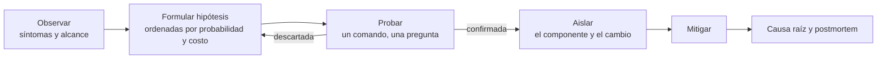
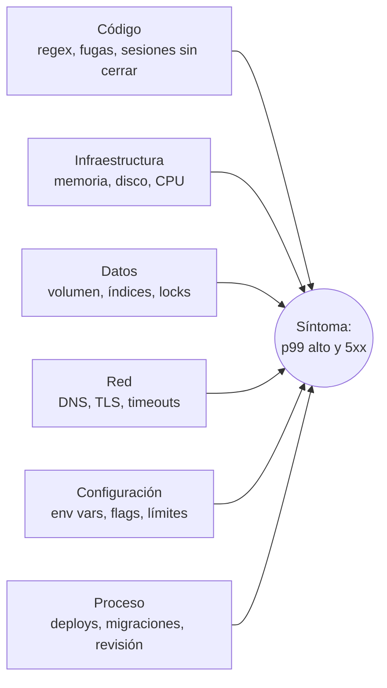

# Metodología de análisis de causa raíz

Esta guía es el "cómo pienso" detrás de cada runbook del laboratorio. La idea es no saltar a la solución apenas aparece un síntoma conocido, sino recorrer un proceso que funciona igual para un incidente que ya viste cien veces y para uno que nunca viste.

## El ciclo: observar, formular hipótesis, probar, aislar



### 1. Observar

Antes de tocar nada, responder con datos:

- **Qué** está roto: qué endpoint, qué operación, lectura o escritura.
- **Para quién**: todos los clientes o algunos, desde adentro de la red o desde afuera.
- **Desde cuándo**: buscar el punto de quiebre en Grafana. Un cambio brusco sugiere un deploy, un flag o un cambio de config. Un crecimiento gradual sugiere fuga de recursos o crecimiento de datos.
- **Qué cambió**: deploys, migraciones, flags, certificados, configuración, tráfico.

Comandos de primera mirada que sirven para cualquier escenario:

```bash
labctl status                                  # vista del cliente a través de nginx
docker compose ps                              # estado, reinicios, health
docker stats --no-stream                       # CPU, memoria y red por contenedor
docker compose logs --since 10m api worker nginx | tail -n 100
curl -sS --cacert certs/ca.crt https://localhost:8443/readyz
```

### 2. Formular hipótesis

Escribir dos o tres hipótesis concretas y comprobables, por ejemplo "la API espera conexiones del pool porque algo las retiene" en vez de "la base anda mal". Ordenarlas por probabilidad y por costo de verificar: primero lo barato.

### 3. Probar

Cada hipótesis tiene que tener un comando que la confirme o la descarte. Si el resultado no cambia lo que pensás hacer, el comando no aportó nada. Anotar cada prueba con su hora: después alimenta la línea de tiempo del postmortem.

### 4. Aislar

Reducir el problema a un componente y a un cambio. Técnicas útiles:

- **Bisección por capas**: cliente → nginx → API → pool → Postgres/Redis → disco/red. Probar cada salto por separado (por ejemplo `curl` directo a `api:8000` desde otro contenedor contra `curl` a través de nginx).
- **Comparar contra una línea base**: el mismo request con y sin carga, el mismo query con `EXPLAIN ANALYZE` antes y después.
- **Reproducir en chico**: un `python -c` que mida una regex, un `psql` que repita la consulta.

### Mitigar no es resolver

La mitigación devuelve el servicio (reiniciar, revertir, matar una sesión). La solución definitiva evita que vuelva a pasar. Mitigar primero está bien, pero antes de reiniciar conviene **guardar evidencia**: `py-spy dump`, `docker inspect`, una consulta a `pg_stat_activity`. Un reinicio borra el estado que explica el problema.

## Método RED (para servicios)

Para cada servicio que atiende requests:

| Señal | Pregunta | Métrica en el laboratorio |
|---|---|---|
| **R**ate | ¿Cuánto tráfico llega? | `sum(rate(http_requests_total{job="orders-api"}[1m]))` |
| **E**rrors | ¿Qué fracción falla? | `sum(rate(http_requests_total{status=~"5.."}[1m])) / sum(rate(http_requests_total[1m]))` |
| **D**uration | ¿Cuánto tarda? | `histogram_quantile(0.99, sum by (le) (rate(http_request_duration_seconds_bucket[1m])))` |

Siempre separar por `route` y `method`: un p99 global alto puede ser un solo endpoint. Y mirar también la vista del cliente (`loadgen_requests_total` por `outcome`): si el RPS del servidor cae pero el cliente sigue enviando, el problema está antes de la API (TLS, DNS, red, nginx).

## Método USE (para recursos)

Para cada recurso (CPU, memoria, disco, red, pool de conexiones, locks):

| Señal | Pregunta | Ejemplos en el laboratorio |
|---|---|---|
| **U**tilization | ¿Qué tan ocupado está? | `rate(process_cpu_seconds_total[1m])`, `db_pool_checked_out / db_pool_capacity` |
| **S**aturation | ¿Hay trabajo esperando? | `http_requests_in_progress`, sesiones esperando locks (`wait_event_type = 'Lock'`) |
| **E**rrors | ¿El recurso devuelve errores? | `OOMKilled`, `ENOSPC`, `QueuePool limit reached` |

El pool de conexiones y los locks también son recursos. Muchos incidentes de "la base está lenta" son en realidad saturación de un recurso lógico con CPU bajo.

## Los 5 porqués

Partir del síntoma y preguntar "¿por qué?" hasta llegar a algo que se pueda cambiar en el proceso o en el sistema, no en una persona.

1. ¿Por qué fallaban las órdenes? Porque el pool de conexiones estaba agotado.
2. ¿Por qué estaba agotado? Porque los requests esperaban un lock de fila en `products`.
3. ¿Por qué había un lock tomado tanto tiempo? Porque la conciliación llama al ERP con la transacción abierta.
4. ¿Por qué se diseñó así? Porque no había una guía sobre trabajo externo dentro de transacciones.
5. ¿Por qué no lo detectamos antes? Porque no había alerta sobre transacciones largas ni `idle_in_transaction_session_timeout`.

Reglas prácticas:

- Si la respuesta es "porque alguien se equivocó", la pregunta está mal hecha. Preguntar por qué el sistema permitió el error.
- Puede haber más de una rama. Está bien terminar con dos o tres causas contribuyentes.
- Cada porqué final debería convertirse en un action item.

## Diagrama de Ishikawa (espina de pescado)

Útil cuando hay muchas causas posibles y conviene ordenarlas antes de probar. Categorías adaptadas a sistemas:



Para cada categoría anotar las candidatas y el comando que las descarta. Así el equipo se reparte la verificación sin pisarse.

## Durante el incidente

- **Un responsable del incidente** coordina, otra persona investiga, otra comunica.
- **Canal único y bitácora con horarios**: cada hallazgo y cada acción con su hora. Es la materia prima del postmortem.
- **Cambios de a uno**: si cambiás dos cosas a la vez no sabés cuál funcionó.
- **Preferir acciones reversibles**: desactivar un flag antes que tocar datos.

## Después: postmortem sin culpas

El postmortem existe para que el sistema aprenda. Se describe qué pasó, qué sabíamos en cada momento y qué decisiones tomamos con esa información, sin buscar culpables. Usar [la plantilla](plantilla-postmortem.md) y revisar los ejemplos de cada escenario en `scenarios/*/postmortem.md`.

## Árbol rápido de síntomas

| Lo que ves | Primeras hipótesis | Primer comando |
|---|---|---|
| Reinicios del contenedor | OOM, crash, healthcheck | `docker inspect rca-lab-api-1 --format '{{.State.OOMKilled}} {{.RestartCount}}'` |
| 5xx con CPU bajo | locks, pool, dependencia caída | `SELECT state, wait_event_type, count(*) FROM pg_stat_activity GROUP BY 1,2;` |
| p99 alto en un endpoint | query sin índice, dependencia lenta | `pg_stat_statements` ordenado por `mean_exec_time` |
| Todo congelado, CPU al 100% | loop o regex, GIL | `docker compose exec api py-spy dump --pid 1` |
| El servidor no ve tráfico pero el cliente falla | TLS, DNS, red | `openssl s_client -connect localhost:8443 -CAfile certs/ca.crt` |
| Solo fallan las escrituras | disco lleno, permisos, locks | `docker compose exec api df -h /data/uploads` |
| readyz falla y liveness no | dependencia inalcanzable | `docker compose exec api getent hosts postgres` |
